# S-100 Chart Display


A browser-based viewer for IHO S-100 nautical chart products: **S-101** electronic navigational charts, **S-102** bathymetric surfaces and **S-104** water levels. It runs on SuperMap iServer chart services and Leaflet. It covers the tasks a hydrographic office or port needs from a chart viewer: changing the chart display, reading depths under keel, checking tides, and querying and measuring features.

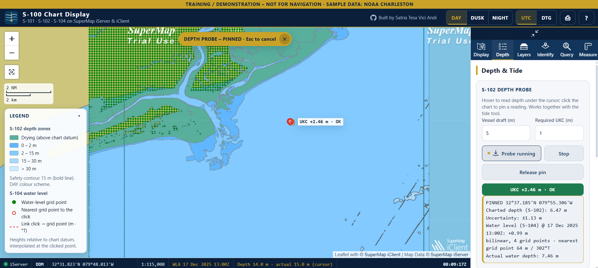

> Training and demonstration tool. Not for navigation. The screenshots were taken on a SuperMap iServer trial licence, which adds the "Trial Use" watermark.

## Feature tour

### 1. Day, dusk and night display
One switch changes the chart colour scheme (S-100 DAY, DUSK, NIGHT) and the interface together, so the screen stays readable from daylight to a dark bridge. The Display tab also exposes the main portrayal parameters: S-104 and S-102 display mode, safety contour (15 m), shallow and deep contours (2 m and 30 m) and the four-shade depth scheme. An **Advanced** section lists every parameter of each product's portrayal catalogue, plus S-98 interoperability (level 0, or level 1 for S-101 combined with S-102).

| Day | Dusk | Night |
| --- | --- | --- |
| 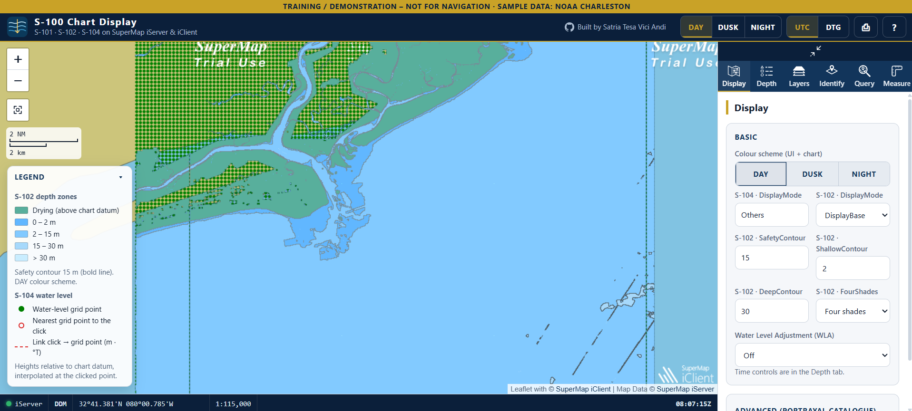 | 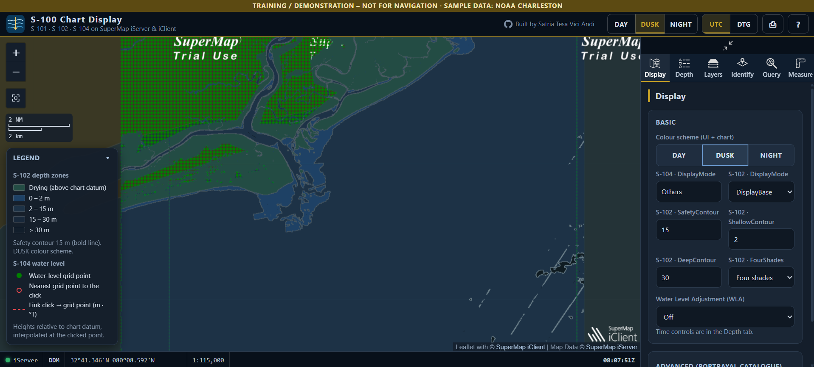 | 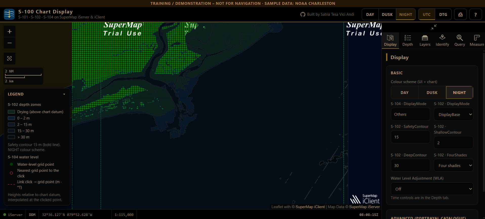 |

### 2. S-102 depth probe with under-keel clearance
Hover over the chart to read the depth under the cursor (shown live in the status bar), or click to pin a reading. Each reading combines:

- the charted depth from S-102 and its uncertainty, for example 6.47 m ± 1.13 m;
- the S-104 water level at the selected time, for example +0.99 m;
- the actual water depth, here 7.46 m, interpolated bilinearly from the 4 surrounding grid points, with the distance and bearing to the nearest one.

With the vessel draft (5 m) and the required under-keel clearance (1 m) entered in the panel, the app shows the clearance as **OK**, **CAUTION** or **NO-GO**, both on the map and in the panel, as in the screenshot at the top of this page.

### 3. S-104 tide at a station
Click near an S-104 grid point to open its water-level curve. The example shows 180 time steps from 17 to 25 December 2025 (minimum −0.08 m, maximum +1.65 m), with the selected time marked. The curve works together with the pinned depth probe.

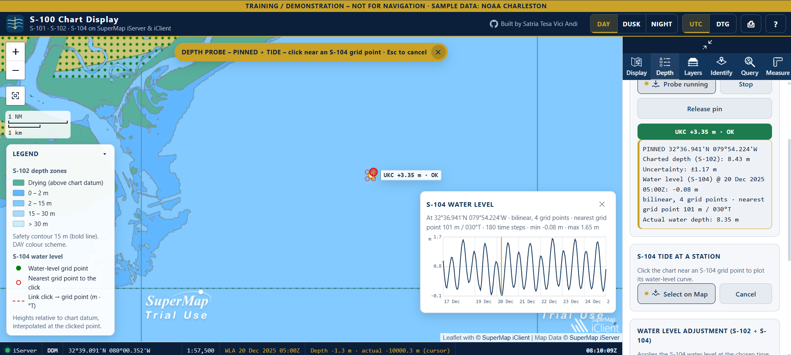

### 4. Water level adjustment (S-102 + S-104)
With WLA on, the S-104 water level at the chosen time is added to the S-102 depths. A time slider covers the whole S-104 period. **Lowest tide** and **Highest tide** jump to the extremes for the last clicked station, and **Play** animates the tide. Times are shown in UTC with the local time below (WIB, UTC+7), and the active WLA time stays visible in the status bar.

| Lowest tide (20 Dec 05:00Z, −0.08 m) | Highest tide (22 Dec 13:00Z, +1.65 m) |
| --- | --- |
| 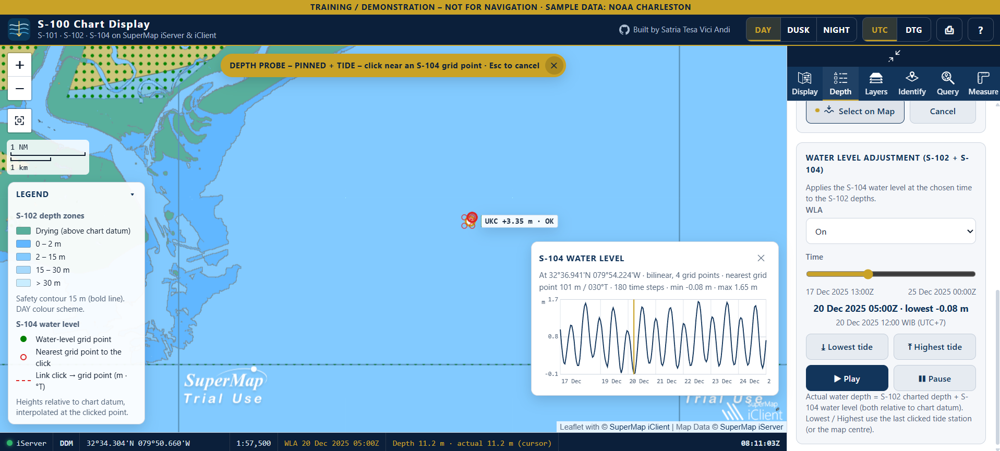 | 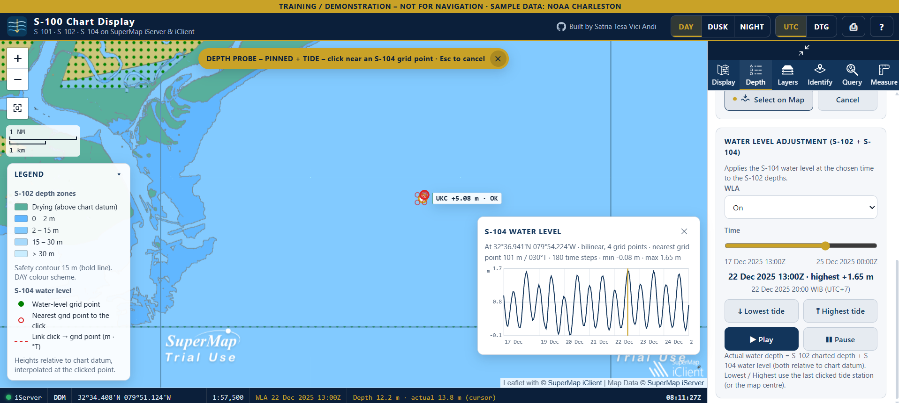 |

### 5. Identify features
**Point** mode lists everything under a click, grouped by product. The example shows an S-102 depth of 6.04 m, an S-104 water level of 1.66 m at 22 December 2025 13:00Z, and the S-57 ENC features at that spot. **Area** mode does the same for a box dragged on the chart. Click any result to see all of its attributes.

| Point | Area |
| --- | --- |
| 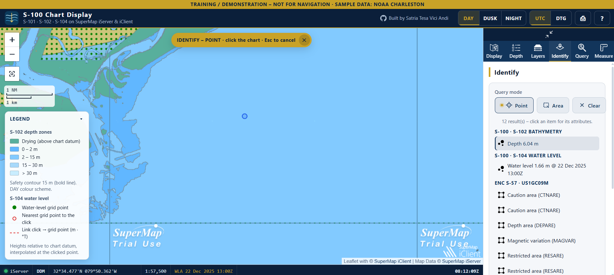 | 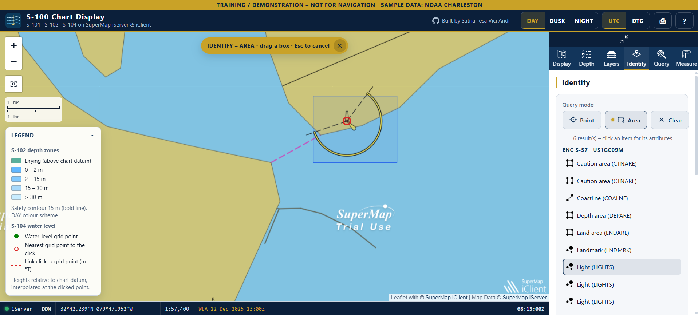 |

The **Query** tab runs an attribute query on one chart layer and feature type, with an optional filter such as `SMID > 0`. The **Layers** tab switches S-100 chart layers, the optional S-57 base chart and online basemaps.

### 6. Measure distance and area
Distances are geodesic, with a bearing in °True for every leg and a running total. The default unit is nautical miles, and cables, metres and kilometres are also available. Areas come with their perimeter, in NM², km², hectares or m².

| Distance and bearing (1.739 NM, 058°T) | Area and perimeter (1.731 NM², 5.314 NM) |
| --- | --- |
| 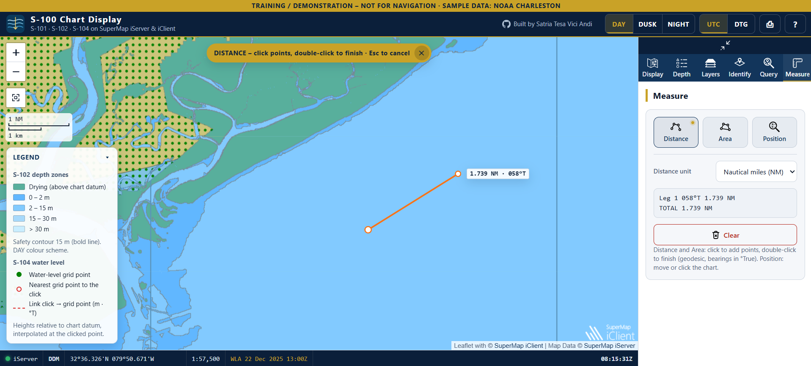 | 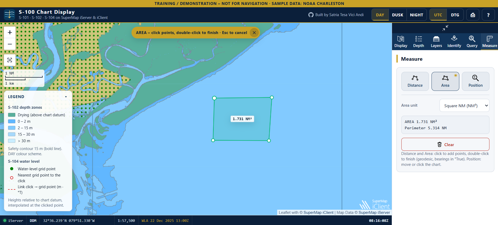 |

### 7. Position in four formats
The Position tool shows the cursor and a picked point in degrees and decimal minutes (the navigator's default), degrees-minutes-seconds, decimal degrees or UTM. **Copy position** puts the picked point on the clipboard. Press <kbd>C</kbd> to cycle the format of the status-bar readout.

| DDM | DMS |
| --- | --- |
|  | 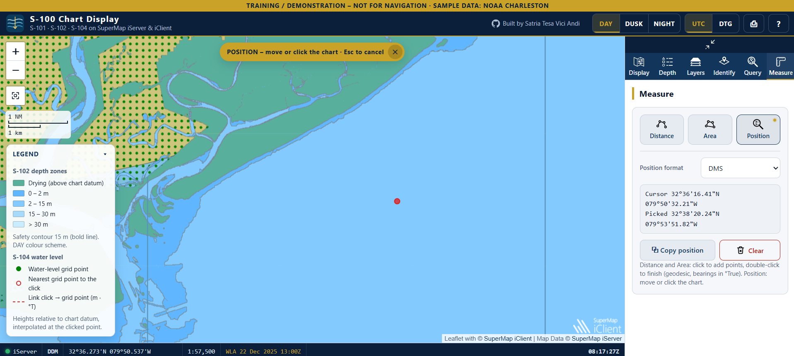 |
| **Decimal degrees** | **UTM** |
|  | 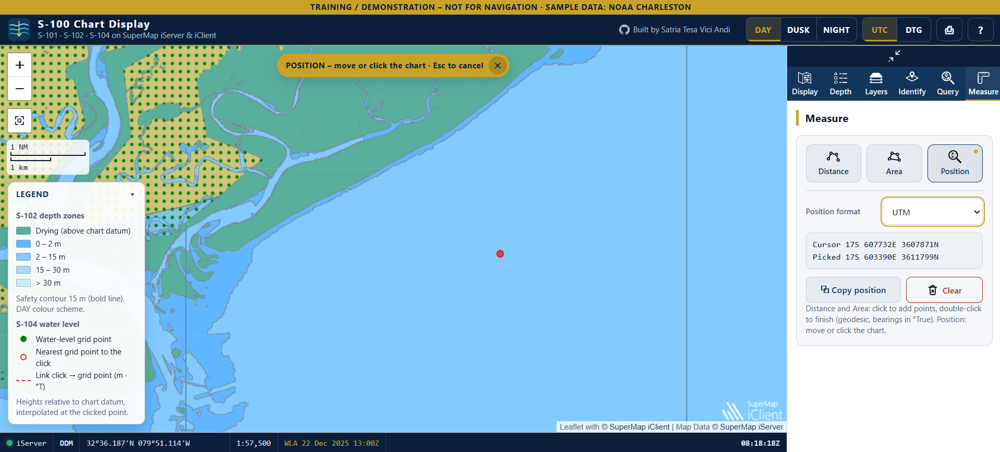 |

### 8. UTC or military date-time group
Times can be shown as UTC (`22 Dec 2025 13:00Z`, clock `08:18:48Z`) or as a military date-time group (`221300Z DEC 25`, clock `070819Z`). The choice applies to the clock, the WLA time and printed output.

| UTC | DTG |
| --- | --- |
| 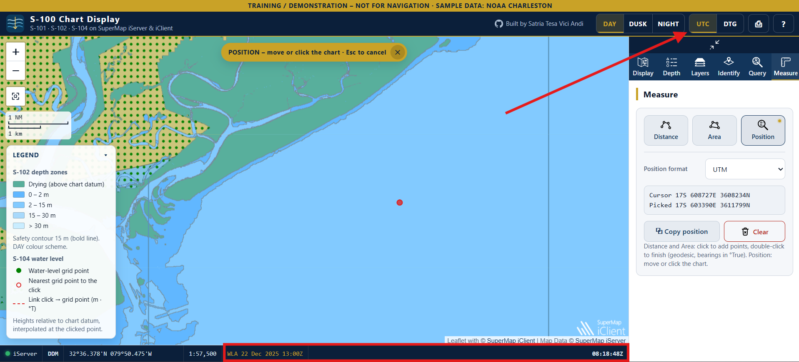 | 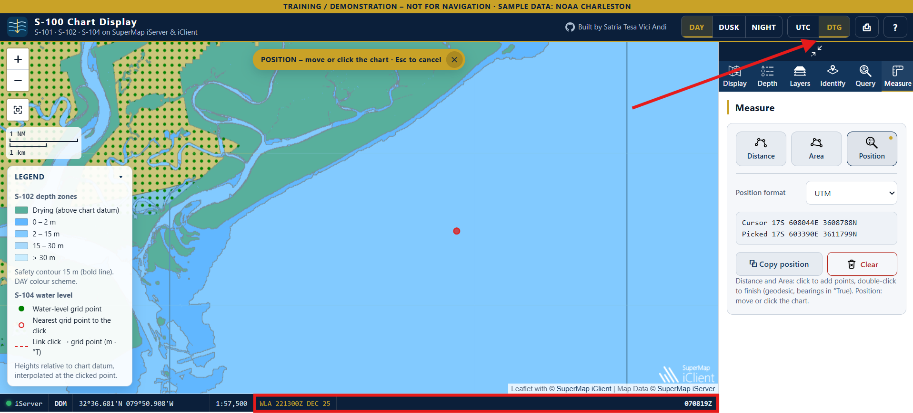 |

### 9. Keyboard shortcuts and status bar
<kbd>1</kbd>–<kbd>6</kbd> open the tabs, <kbd>Esc</kbd> cancels the active tool, <kbd>L</kbd> toggles the legend, <kbd>C</kbd> cycles the position format and <kbd>Z</kbd> zooms to the chart extent. A chip at the top of the map always says which tool is active. The status bar shows the iServer connection (checked every 30 seconds), cursor position, scale, zoom, WLA time, live depth and the clock.

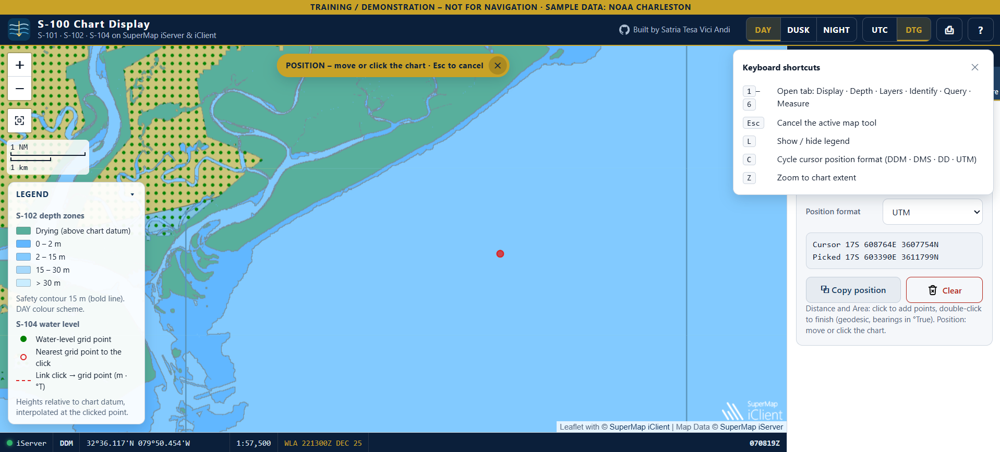

### 10. Print and save as PDF
The print layout adds the "not for navigation" banner, title, print time, map centre, scale, WLA time and theme. It also carries the pinned depth reading with its clearance, the tide curve and the legend, so a saved PDF documents the reading on its own.

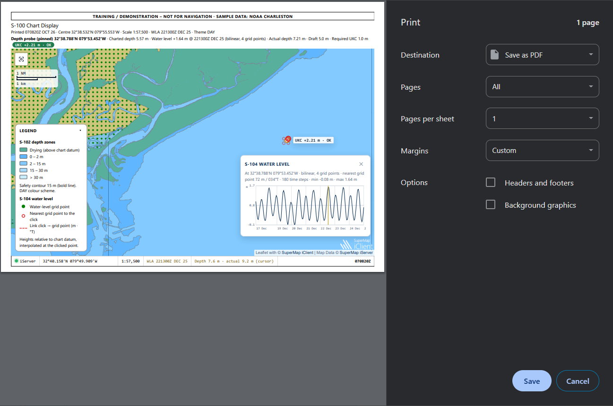

## How it works

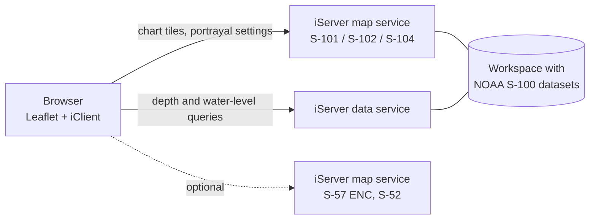

The client uses SuperMap iClient for Leaflet's `ChartService` to read and change portrayal parameters (`getChartMaritimePcInfo`). It reads S-102 depths with `getChartWaterDepth`, after converting the clicked position to the dataset's UTM zone, and reads S-104 water levels from the published position, time and water-level datasets. To keep the map responsive, depth and tide readings are cached per grid cell, and every network call shows its progress in the status bar.

## Requirements

| Requirement | Notes |
| --- | --- |
| Node.js 18+ and npm | Build and development server |
| SuperMap iServer 2026 with the Chart service extension | Publishes the S-100 map and data services |
| S-100 sample data | NOAA test datasets for Charleston, South Carolina (S-101, S-102, S-104), plus the matching S-57 ENC if you want the base chart |

## Getting started

1. Publish the S-100 datasets in iServer as one **map service** and one **data service**. If you use the S-57 ENC, publish it as a separate map: when a map mixes S-57 and S-100, iServer returns S-57 chart settings only.
2. Edit [`src/s100.config.js`](src/s100.config.js) and set `MAP_URL`, `DATA_URL` and, optionally, `ENC_MAP_URL`. Check the S-104 dataset names at `<DATA_URL>/datasources/<S104_DATASOURCE>/datasets.json`, and set `S102_CRS` to your data's UTM zone.
3. Install and run:

```bash
npm install
npm run dev          # http://localhost:5173
```

For a production build served by Express:

```bash
npm run build        # set BASE_PATH=/sub/path/ when serving under a sub-path
npm start            # http://localhost:2000
```

## Project structure

```
src/
  index.html        layout: header, map, status bar, side panel with six tabs
  s100.config.js    service URLs, dataset names, initial view, defaults
  s100.js           map, portrayal settings, depth and tide tools, query, measure
  s100.css          theme palettes (DAY / DUSK / NIGHT) and components
  styles.css        Tailwind base and layout helpers
public/img/         interface icons
server/index.js     Express server for the production build
```

## Design notes

- **One configuration file.** Moving to another iServer or dataset means editing `s100.config.js` only.
- **The palette controls the whole screen.** The DAY, DUSK and NIGHT schemes change the chart and the interface together, so the screen stays readable on a bridge at night.
- **Navigator conventions.** Positions default to degrees and decimal minutes, distances to nautical miles, bearings to true north, and times to UTC.
- **Safety first in the interface.** A "not for navigation" banner, a clear under-keel clearance verdict, and visible loading and connection states.

## Data

Sample data: NOAA Office of Coast Survey S-100 test datasets and ENCs for Charleston, SC ([NOAA nautical charts](https://nauticalcharts.noaa.gov/)). The data is not part of this repository.

## Author

**Satria Tesa Vici Andi**, GIS Engineer working on enterprise GIS, WebGIS and hydrographic data.
[GitHub](https://github.com/satriatva) · [LinkedIn](https://www.linkedin.com/in/satriatesaviciandi)

## License

[MIT](LICENSE). SuperMap iServer and iClient are products of SuperMap Software Co., Ltd., used under their own licenses.
